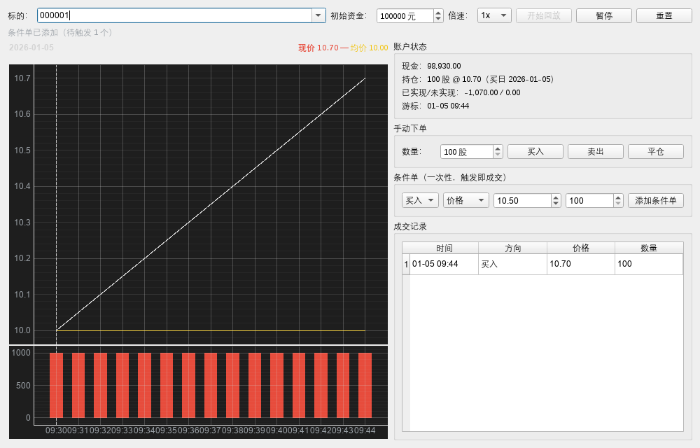
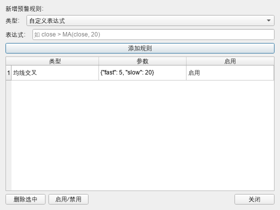
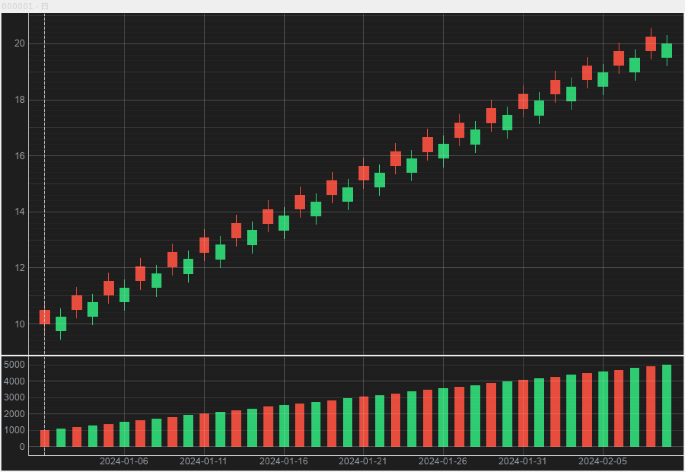
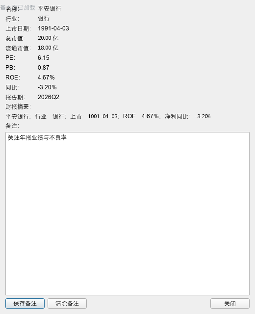
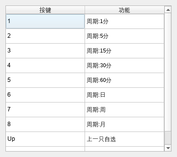
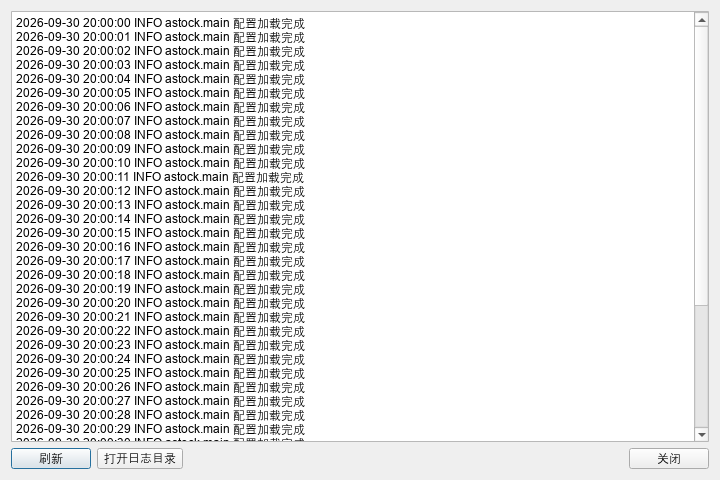

# A股量化分析平台


一个**单机桌面版 A 股「看盘 + 选股 + 策略研究」**应用。

它不只是看盘工具：在内置的分析引擎之上，可以**把交易想法变成可回测、可验证的实验**，并用显式手段规避金融数据分析中最常见的四类陷阱（前视偏差、幸存者偏差、复权口径、数据缺失）。

> 定位：个人研究项目 · 非商业转售 · 非实时行情推送（数据需手动更新）

---

## ✨ 核心功能

### 行情与选股（工具层）

| 模块 | 说明 |
|---|---|
| 自选股管理 | 分组管理、右键菜单、重启持久化 |
| K 线图 | 红涨绿跌蜡烛 + 成交量副图，缩放/平移/X 轴联动，悬停显示 OHLC |
| 多周期 | 日 / 周 / 月 / 1 / 5 / 15 / 30 / 60 分钟（周月线由日线自动派生） |
| 分时图 | 独立页面，回放时钟 |
| 辅助标注 | 涨停/跌停蜡烛着色、跳空缺口、除权竖线 |
| 自定义指标 | Python 表达式 + AST 白名单沙箱，可保存复用 |
| 多条件选股 | 基本面 + 技术面混合条件筛选 |
| 行情预警 | 指标信号触发弹窗 + 提示音 + 托盘 |
| 结果导出 | 选股结果导 Excel、K 线图导高清 PNG（DPI=300） |
| 个股备注 | 详情弹窗 + 星标 |
| 模拟交易训练 | 历史行情重放，`as_of` 强制屏蔽未来；T+1、仅做多、无费 |
| 备份恢复 | 一键 zip 打包/还原 |

### 策略研究（分析层，核心价值）

| 模块 | 说明 |
|---|---|
| 策略回测引擎 | 单/多标的历史回测，输出累计收益、超额、最大回撤、夏普、胜率、盈亏比 |
| 绩效归因 | 分牛熊市段拆分表现，α / β 归因，成本模型 |
| 多因子有效性检验 | 12 个价量因子；Rank IC（Newey-West 修正）+ 分层多空年化**双口径交叉验证**；共线性 VIF |
| 数据质量审计 | 缺失/异常/成分股快照审计，处理幸存者偏差 |
| 多因子打分 | 因子合成打分并回测 |
| 策略风控 | 止损/回撤限制等规则可配置（经实测为负贡献，默认关闭） |
| 多策略组合 | 分账、等权净值合并、相关性、贡献归因 |
| 成员筛选与组合验证 | 样本内筛选 + 样本外验证 + 全样本上界参考，四线组合对比 |

---

## 🔑 研究结论（项目最有价值的部分）

项目按 8 个阶段逐步深入，沉淀出以下**基于真实数据的结论**：

| 阶段 | 研究问题 | 结论 |
|---|---|---|
| 1–2 | 策略赚不赚钱？钱从哪来？ | 收益主要来自**选股 α**（非大盘 β）；最大回撤 **−44.6%**、修复约 **4.5 年** → 实盘必须配风控 |
| 3 | 12 个因子哪些真有效？ | 仅 **20 日成交额**、**5 日短期反转** 双口径同向显著；5 个为「假信号」、4 个高共线 |
| 4 | 数据本身干不干净？ | 全流程采用**时点（PIT）成分股快照**，规避幸存者偏差 |
| 5 | 有效因子怎么落地？ | 合成多因子打分模型，可回测验证 |
| 6 | 加风控规则有用吗？ | **反直觉：所有实测风控规则均为负贡献** → 系统默认全部关闭，仅留研究开关 |
| 7 | 多策略组合是否更好？ | **「组合是诚实的容器」**——不改变期望，成员质量决定一切 |
| 8 | 用历史成绩挑策略有用吗？ | **「防雷不增效」**——筛选能剔除烂策略，但几乎不提升收益质量 |

### 阶段 8 的关键实证（样本外：2021 年起，基准 −18.04%）

| 口径 | 样本外收益 | 夏普 |
|---|---|---|
| 筛选前 · 15 个候选等权 | +31.20% | 0.46 |
| **筛选后 · 样本内合格 5 个等权** | **+36.43%** | 0.45 |
| 上界参考 · 全样本合格 3 个等权（开卷） | +72.95% | 0.64 |
| 对照 · 样本内「夏普最高」的单个策略 | **−41.43%** | −0.49 |

- **样本内排名 vs 样本外排名的 Spearman 相关性 = −0.09 ≈ 0**：**过去表现好完全不能预测未来表现**，样本内冠军在样本外垫底。
- 「开卷上界」多出的约 36 个百分点使用了未来信息，实盘不可得 —— 可用信息下的合理预期应贴近「筛选后」组合。

### 四大数据陷阱的处理

| 陷阱 | 项目处理方式 |
|---|---|
| **前视偏差 / 未来函数** | 信号仅用 T 日及以前数据；成交价取 T+1 开盘价 |
| **数据窥探 / 过拟合** | 样本内（2015–2020）筛选 + 样本外（2021 起）验证 + 全样本上界参考 |
| **幸存者偏差** | 使用历史时点成分股快照（PIT），而非当前名单 |
| **复权口径** | 统一前复权（qfq）价格，避免把分红误读为下跌 |

---

## 🖼 截图

> 完整截图见 [`docs/screenshots/`](docs/screenshots/)

| 模拟交易训练 | 行情预警管理 |
|---|---|
|  |  |

| 选股结果导出 | 个股备注 |
|---|---|
|  |  |

| 快捷键说明 | 日志查看器 |
|---|---|
|  |  |

---

## 🏗 架构

**三层分层架构**，引擎层**严禁依赖任何 Qt 代码**，保证可独立单测、可替换 UI：

```
UI 层      PySide6 + PyQtGraph
  ↓ 调用
引擎层     纯 Python：指标沙箱 / 选股 / 预警 / 模拟训练 / 回测 / 因子 / 质量审计
  ↓ 调用
数据层     数据源适配(AkShare/BaoStock/pytdx) · 本地存储(SQLite/Parquet) · 更新编排
  └── 基础设施：配置 / 日志 / 事件总线 / 主题
```

### 目录结构

```
astock/
├── main.py                  # 程序入口
├── requirements.txt
├── config/                  # settings.yaml / logging.yaml
├── app/
│   ├── core/                # 配置 / 日志 / 事件总线 / 备份
│   ├── data/                # 数据源适配 · SQLite 存储 · 更新服务 · 数据模型
│   ├── engine/              # ★ 分析引擎（零 Qt 依赖）
│   │   ├── backtest/        #   回测 · 归因 · 基准 · 成本 · 风控 · 组合 · 成员筛选
│   │   ├── factor/          #   因子定义 · 面板 · IC · 分层 · 共线性 · 打分
│   │   ├── quality/         #   数据质量审计
│   │   ├── indicator/       #   指标引擎 + AST 沙箱
│   │   ├── screener/        #   多条件选股
│   │   ├── alert/           #   预警服务
│   │   └── simulator/       #   回放时钟 · 交易规则 · 模拟状态
│   ├── ui/                  # 主窗口 · 各功能对话框 · 主题
│   └── export/              # Excel / 高清图导出
├── docs/                    # 文档与截图
└── tests/                   # pytest 测试（1165 个）
```

---

## 🚀 快速开始

### 环境要求

- Windows 10 / 11 (64-bit)
- Python 3.13

### 安装

```powershell
git clone https://github.com/<你的用户名>/astock-quant-platform.git
cd astock-quant-platform

python -m venv .venv
.venv\Scripts\activate
pip install -r requirements.txt
```

### 运行

```powershell
python main.py
```

首次使用：**先「加自选」→ 再点「更新数据」**（联网下载历史行情，默认自 2015-01-01 起）。

### 测试

```powershell
# 全量单元测试
python -m pytest -q

# 无界面冒烟自检（末行输出 SMOKE_TEST_OK 即正常）
$env:QT_QPA_PLATFORM="offscreen"
python -m app.smoke_test
```

> 离屏环境下出现 `QFontDatabase: Cannot find font directory` 等告警属正常现象，非故障。

---

## 🧰 技术栈

| 维度 | 选型 |
|---|---|
| 语言 | Python 3.13 |
| GUI | PySide6（LGPL） |
| 图表 | PyQtGraph（交互） + matplotlib/mplfinance（高清导出） |
| 数据处理 | pandas · numpy · pandas-ta |
| 数据源 | AkShare（主） · BaoStock（兜底） · pytdx（1 分钟历史） |
| 存储 | SQLite 单文件（+ Parquet 兜底） |
| 安全 | AST 白名单 + 受限命名空间沙箱，禁用裸 `eval` |
| 测试 | pytest |

---

## 📄 文档

| 文档 | 内容 |
|---|---|
| [`docs/`](docs/) | 项目文档与界面截图 |
| 【外部】项目介绍（零基础版） | 面向非技术读者的通俗介绍 |
| 【外部】面试应对文档 | 项目相关的面试问答准备 |

---

## ⚠️ 已知局限

- 样本外验证仅覆盖**单一区间**（2021 年起），尚未做 bootstrap 显著性检验。
- 「全样本上界参考」为方法论对照，**不可实盘复制**。
- 风控规则经实测为负贡献，默认关闭，仅保留开关供研究。
- 未做完整的交易成本与滑点建模；回测结论**不构成投资建议**。

---

## 📜 声明

本项目为**个人学习与研究用途**，数据来源于公开免费接口，**不用于商业转售**。软件不提供实时行情推送，所有回测与分析结果仅供研究参考，**不构成任何投资建议**。
